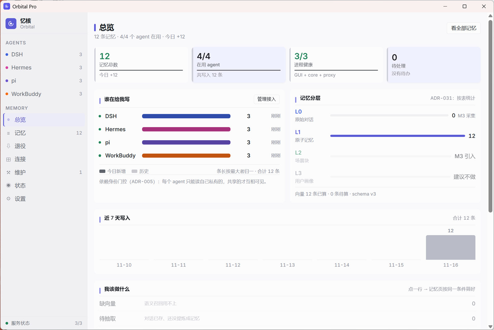
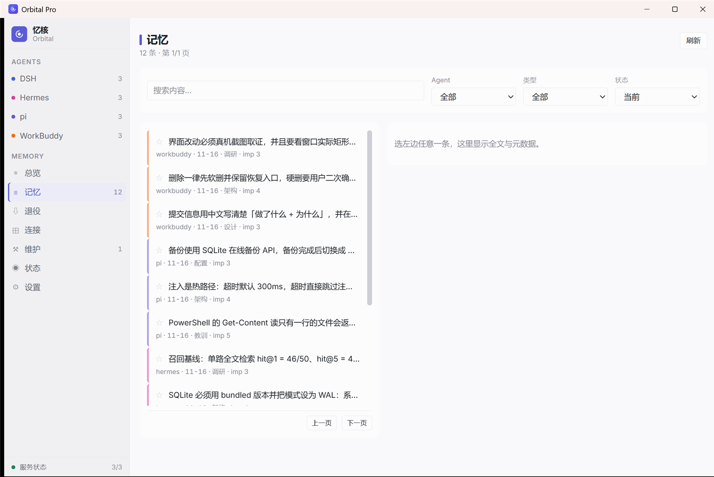
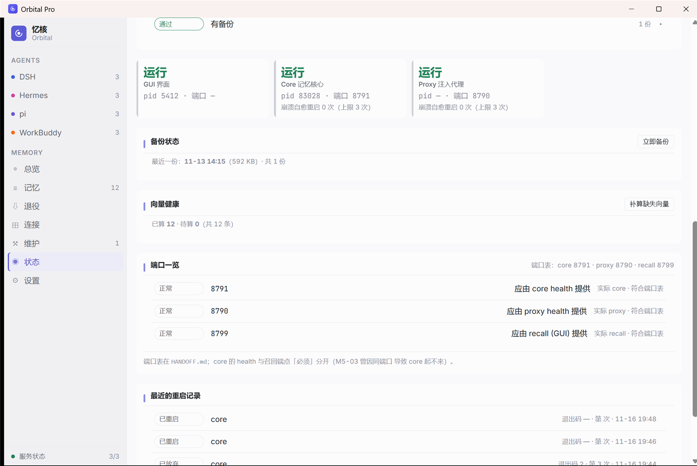
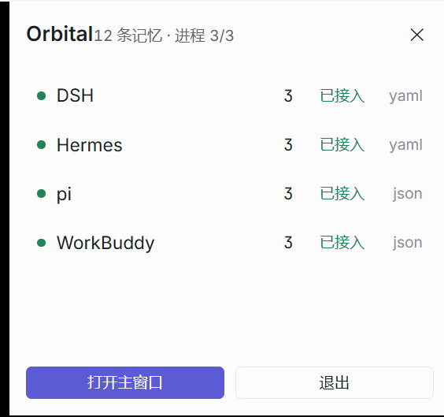

# Orbital Pro · 忆核

> 一个给**多个 AI Agent 共用**的本地记忆中枢：记得住、找得到、管得动、忘得掉。


> [!WARNING]
> **仅限学习与研究，禁止商用。**
> 本项目采用 [PolyForm Noncommercial 1.0.0](LICENSE)，**不是** OSI 认证的开源许可，更准确的说法是
> **source-available（源码可见）**。你可以阅读、学习、修改、在个人或教学场景使用；
> **不得**把它放进商业产品、对外提供付费服务、或在公司生产环境部署。

---

## 这个项目在解决什么问题

当你同时使用 DSH、Hermes、pi、WorkBuddy 这类 AI Agent 时，会出现三个很烦的问题：

1. **记忆是碎的** —— 每个 Agent 各记各的，你在 A 里说过的约定，B 完全不知道；
2. **记了什么不知道** —— 记忆藏在配置文件或数据库里，没有界面能看、能改、能删；
3. **删不掉 / 删错了** —— 想让 Agent 忘掉某件事，往往只能全局清空或手改文件。

Orbital Pro 把记忆抽出来做成一个**本机独立服务**：所有 Agent 读写同一份库，
你在一个界面里能看到全部内容、来源、关系，每条操作都可审计、可回溯、可撤销。

## 主要特性

| 特性 | 说明 |
|---|---|
| **跨 Agent 共享** | 一个本地库，四种 Agent 通过各自官方通道接入（MCP 工具 / 生命周期 hook / 受控文件区块 / HTTP 代理） |
| **一个数字都能点** | 界面是操作台不是看板：记忆条数、Agent 分布、向量缺口都能点进去处理 |
| **可审计** | 每次写入/修改/删除/合并都落 `memory_events`，能在「维护」页看到最近操作 |
| **可撤销** | 删除默认软删（可恢复），硬删要二次确认；合并可撤销；退役可恢复 |
| **注入不阻塞** | 注入是对话热路径：默认 300ms 超时，超时**直接跳过**，绝不让用户等 |
| **端口自愈** | 端口被别的软件占用时自动顺延，界面显示实际端口 |
| **托盘常驻** | 关闭主窗=隐藏；右键托盘弹紧凑面板；失焦自动收起 |
| **本机优先** | 数据全在本地 SQLite（WAL 模式），不依赖任何云服务 |

## 界面

概览页 —— 一眼看清记忆规模、Agent 分布、记忆分层与近期写入：



记忆页 —— 左侧列表 + 右侧详情，支持搜索、按 Agent/类型/状态筛选：



状态页 —— 进程健康、端口一览、一键体检（每项都有判据）：



托盘面板 —— 右键托盘图标弹出的紧凑视图，一项一 Agent：



> 以上截图来自**演示库**（[`examples/demo-seed.rs`](crates/orbital-core/examples/demo-seed.rs) 生成的虚构数据），不含任何真实用户内容。

## 架构

```
┌─────────────────────────────────────────────────────────────┐
│                        GUI (Tauri + React)                  │
│   概览 / 记忆 / 退役 / 连接 / 维护 / 状态 / 设置 + 托盘面板    │
└───────────────┬─────────────────────────────┬───────────────┘
                │ spawn & supervise            │ 只读查询（WAL 多读者）
                ▼                              ▼
┌──────────────────────────┐        ┌──────────────────────────┐
│  core（记忆核心）         │        │   SQLite（WAL）           │
│  · 写队列 · 版本链        │◄──────►│   memories / events       │
│  · 召回三通道 · 退役      │        │   edges / facts / conflicts│
│  · /health 健康端点       │        └──────────────────────────┘
└──────────────────────────┘                    ▲
                ▲                               │ 只读召回端点
                │ 注入请求（300ms 超时即跳过）    │ 127.0.0.1:8799
┌───────────────┴──────────────┐                │
│  proxy（注入代理，可选）       │────────────────┘
└───────────────┬──────────────┘
                │ Agent 各自的官方通道
    ┌───────────┼───────────┬──────────────┐
    ▼           ▼           ▼              ▼
   DSH        Hermes        pi         WorkBuddy
  MCP 工具   pre_llm_call  before_agent_start  MEMORY.md 受控区块
```

**三进程**（`docs/02`、ADR-004）：GUI 是父进程，负责拉起并监控 core 与 proxy。
任何一个子进程崩溃会被看门狗按指数退避重启（最多 3 次），超过则明确上报而不是无限刷。

**三条硬规则**：

- core 是唯一写入口（写队列），GUI 只读；
- 注入只读，绝不在热路径写库；
- 任何"未确认来源"的请求只能看到 `scope=shared` 的记忆，`private` 不外泄（ADR-042）。

## 快速开始

### 方式一：安装包（Windows）

1. 从 [Releases](https://github.com/EricTangLi/orbital-pro/releases) 下载 `Orbital.Pro_x.y.z_x64-setup.exe`；
2. 运行安装（未签名，Windows 会提示"未知发布者"，属正常）；
3. 启动后在「设置 → 记忆注入接入」里一键接入你使用的 Agent。

数据目录：`%LOCALAPPDATA%\OrbitalPro`（卸载**不会**删除数据）。

### 方式二：从源码构建

需要 **Rust 1.90+**、**Node.js 20+**、Windows 10/11。

```powershell
git clone <this-repo>
cd orbital-pro

# 1) 前端
npm install
npm run build

# 2) 核心二进制（根 workspace）
cargo build --release

# 3) 桌面应用 + 安装包
cd src-tauri
cargo build --release
cd ..
npx tauri build        # 生成 NSIS 安装包
```

> 注意顺序：`npx tauri build` **不会**重新编译根 workspace 的 `orbital-mcp` / `orbital-proxy`，
> 必须先跑 `cargo build --release`，否则安装包里是旧二进制。

### 生成演示数据（可选）

```powershell
$env:ORBITAL_DB_PATH="$env:TEMP\orbital-demo\orbital.db"
cargo run -p orbital-core --example demo-seed -- "$env:ORBITAL_DB_PATH" "$env:TEMP\orbital-demo\journal.ndjson"
# 再用同一个 ORBITAL_DB_PATH 启动应用，就能看到截图里的演示界面
```

## 接入 Agent

| Agent | 接入通道 | 落点 |
|---|---|---|
| **DSH** | MCP 工具 + `agent/pre-step` 插件 | `.dsh/profiles/*/cordis.patch.yml` + 适配器目录 |
| **Hermes** | shell hook `pre_llm_call` | `hermes/agent-hooks/orbital-recall.py` |
| **pi** | 扩展 `before_agent_start` | `.pi/agent/extensions/orbital.ts` |
| **WorkBuddy** | `MEMORY.md` 受控区块 | `.workbuddy/user-*/MEMORY.md` |

每种接入都走**各自官方的写入口**（`hermes config set` / `dsh plugin add` / 只改受控区块），
移除时只删自己那一段并留备份（`.bak.orbital*`），不会破坏你原有的配置。

## 项目结构

```
orbital-pro/
├─ crates/
│  ├─ orbital-core/     记忆核心：库、写队列、召回、退役、备份（库 crate）
│  ├─ orbital-mcp/      MCP server（给 Agent 用的 stdio 工具）
│  └─ orbital-proxy/    注入代理（OpenAI 兼容路径上做召回注入）
├─ src-tauri/           Tauri 壳：窗口、托盘、启动器、命令层
├─ src/                 React 前端（Vite + TypeScript）
├─ docs/                设计文档（00 章程 … 34 用户指南 + ADR）
├─ design/              UI 设计稿（HTML 高保真）
├─ scripts/             门禁脚本：check-plan / check-docs / check-links / verify
└─ plans/               里程碑任务卡（开发过程记录）
```

## 设计文档

项目的"为什么"都写在 `docs/` 里，最值得读的几篇：

| 文档 | 内容 |
|---|---|
| [`docs/01`](docs/01-产品定义-PRD.md) | 产品定义：8 个 JTBD（用户要完成的事）与优先级 |
| [`docs/02`](docs/02-系统架构.md) | 系统架构：三进程、三通道、失败防护 |
| [`docs/04`](docs/04-记忆系统设计.md) | 记忆系统设计：数据模型、召回、退役公式（含设计追溯表） |
| [`docs/07`](docs/07-架构决策记录.md) | **ADR 合集**（架构决策记录，至 ADR-055）：每条都有背景、被否方案、不许回退的理由 |
| [`docs/09`](docs/09-踩坑与反模式.md) | 踩坑与反模式：真实踩过的坑，包括"注释说做了、代码没做" |
| [`docs/34`](docs/34-用户指南.md) | 用户指南 |

> 说明：`docs/` 中有 74 处结论引用 `evidence/`（开发过程的截图与实测日志）。
> 为保护个人数据，`evidence/` **未随仓库公开**，因此这些相对链接在 GitHub 上会 404。
> 结论本身可独立阅读；需要证据时请以文中描述、`docs/07` 的 ADR 与代码实现为准。

## 质量与测试

| 项 | 数字（2026-11-16 实测） |
|---|---|
| Rust 测试 | **159 passed**：根 workspace 141（2026-11-14 实测）＋ `src-tauri` 18（2026-11-16 实测） |
| 静态检查 | `cargo clippy` 0 warning；`tsc --noEmit` 通过 |
| 文档门禁 | `check-links` 123 项链接 / 41 文件全通过 |
| schema | v3（启动时自动迁移，旧库不拒绝服务） |
| 召回基线 | 单路全文检索 hit@1 46/50、hit@5 47/50、MRR 0.9267 |

```powershell
cargo test --workspace                 # 根 workspace
cargo test --manifest-path src-tauri/Cargo.toml
powershell -NoProfile -File scripts/verify.ps1
```

## 已知限制

- **仅 Windows**：托盘、窗口状态、进程管理与安装包都依赖 Windows API；核心库理论上可移植，未验证；
- **无自动更新**：安装包未签名，也没有 updater；
- **召回端点端口固定** 8799（`core`/`proxy` 端口可顺延，recall 暂未顺延）；
- **单机单用户**：没有账号体系，权限模型基于"本机所有者 + Agent 令牌"；
- **向量检索需自备嵌入端点**：未配置时自动降级为关键词检索（并在界面明示）。

## 路线图

- [ ] 召回端点端口也支持顺延
- [ ] 注入统计区分"超时"与"无命中"
- [ ] 向量覆盖率一键补算的进度可视化
- [ ] 更细的 Agent 作用域（按项目隔离）

## 参与贡献

欢迎提 Issue 与 PR。提交前请先读 [CONTRIBUTING.md](CONTRIBUTING.md)。

**特别欢迎**这几类贡献：文档纠错、可复现的 Bug 报告、测试补充、Windows 兼容性问题。

安全相关问题请走 [SECURITY.md](SECURITY.md) 的私下渠道，不要公开提 Issue。

## 许可证

[PolyForm Noncommercial 1.0.0](LICENSE) —— **仅限非商业用途**。

本项目**不是** OSI 开源项目（OSI 开源许可不允许限制使用领域）。
公开代码的目的是学习与交流，**不构成**任何商业授权。

## 致谢

- [Tauri](https://tauri.app/)、[React](https://react.dev/)、[Rust](https://www.rust-lang.org/) 提供了全部基础设施；
- 记忆系统的设计参考了多篇公开论文与开源实现的思路，代码为独立实现；
- UI 视觉参考 [Linear](https://linear.app/) 的克制风格与 [Radix](https://www.radix-ui.com/) 的色板体系。
